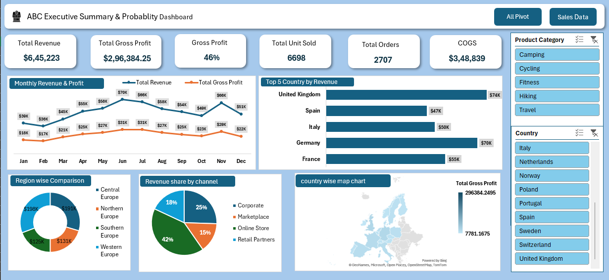

# ABC Executive Summary & Profitability Dashboard

### Dashboard Preview

### Project Overview
Analyzed 2707 orders & 6698 units for ABC Company to track Revenue, Profit and Regional Performance across Europe.

### Tools Used
Microsoft Excel, Pivot Tables, Pivot Charts, Slicers, Data Visualization

### KPIs
- **Total Revenue:** $6,45,223
- **Total Gross Profit:** $2,96,384.25
- **Gross Profit Margin:** 46%
- **Total Units Sold:** 6698
- **Total Orders:** 2707
- **COGS:** $3,48,839

### Key Insights
1. June is highest revenue month ($70K)
2. UK is top country with $74K revenue
3. Western Europe is top region with $198K revenue
4. Online Store is best sales channel with 42% share
5. Camping is top product category ($198K revenue)

### Dashboard Features
- 6 KPI Cards
- Monthly Revenue & Profit Trend (Line Chart)
- Top 5 Countries by Revenue (Bar Chart)
- Revenue by Region & Channel (Donut & Pie Chart)
- Sales Map by Country
- 2 Slicers - Product Category & Country

### Files
- ABC-Executive-Dashboard.png - Dashboard Screenshot
- Excel_Sales_Dashboard.xlsx - Raw Data (2707 Rows)
